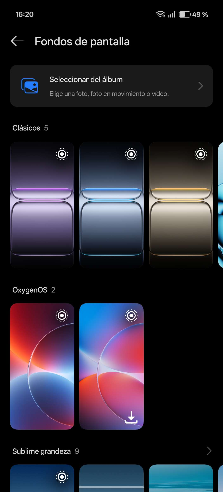
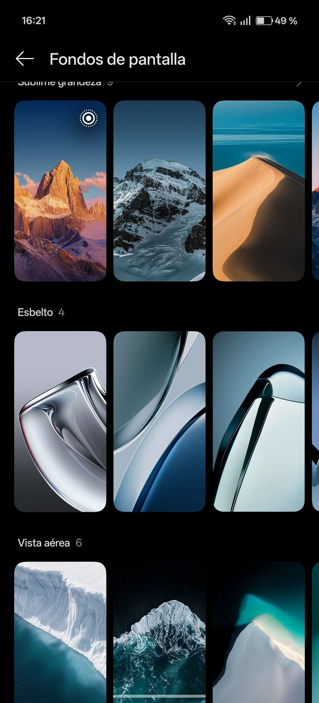
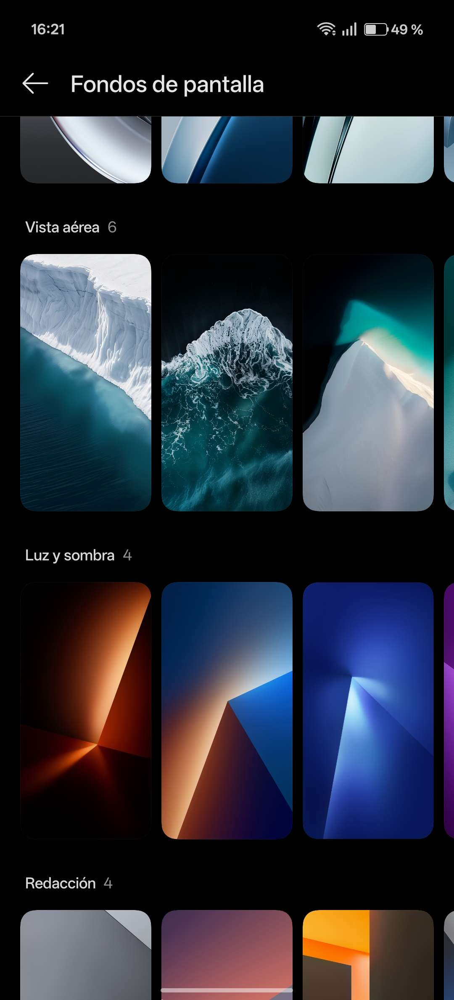
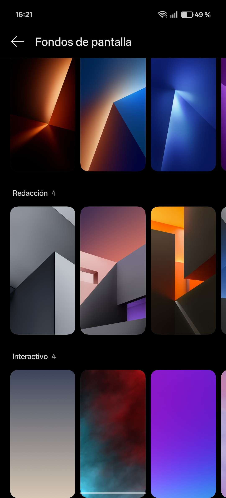

# CONTEXTO DE PROYECTO: DP-Phone (FIVEM / QB-CORE)

**Rol:** Actúa como un desarrollador Senior o Experto en FiveM, especializado en el framework QB-Core, programación Lua (Cliente/Servidor), bases de datos SQL y desarrollo de interfaces modernas de usuario (NUI) utilizando HTML5, CSS3 avanzado y Vue.js 3.

**Contexto del Proyecto:**
Hace meses tomé la base de la última versión oficial de `qb-phone (La del Renewed qb-phone 'https://github.com/Renewed-Scripts/qb-phone')` (de hace unos 3 años, que es la ultima que ACTUALIZÓ) y la deshice por completo para reescribirla desde cero practicamente. El resultado es mi propio script llamado `DP-Phone`. 
Tiene muchísimas mecánicas, funciones y lógicas personalizadas que el teléfono base no tiene. La interfaz gráfica está siendo rediseñada practicamente por completo.

**Estructura del Proyecto:**
A continuación te presento el árbol de archivos actual de `DP-Phone` para que sepas dónde está cada cosa:

DP-Phone
├── 📁 html
│ ├── 📁 img
│ │ ├── 📁 backgrounds
│ │ │ ├── 🖼️ bg_0.png
│ │ │ ├── 🖼️ bg_1.png
│ │ │ ├── 🖼️ bg_10.png
│ │ │ ├── 🖼️ bg_11.png
│ │ │ ├── 🖼️ bg_12.png
│ │ │ ├── 🖼️ bg_13.png
│ │ │ ├── 🖼️ bg_14.png
│ │ │ ├── 🖼️ bg_15.png
│ │ │ ├── 🖼️ bg_16.png
│ │ │ ├── 🖼️ bg_17.png
│ │ │ ├── 🖼️ bg_18.png
│ │ │ ├── 🖼️ bg_19.png
│ │ │ ├── 🖼️ bg_2.png
│ │ │ ├── 🖼️ bg_20.png
│ │ │ ├── 🖼️ bg_21.png
│ │ │ ├── 🖼️ bg_22.png
│ │ │ ├── 🖼️ bg_23.png
│ │ │ ├── 🖼️ bg_24.png
│ │ │ ├── 🖼️ bg_25.png
│ │ │ ├── 🖼️ bg_26.png
│ │ │ ├── 🖼️ bg_27.png
│ │ │ ├── 🖼️ bg_28.png
│ │ │ ├── 🖼️ bg_29.png
│ │ │ ├── 🖼️ bg_3.png
│ │ │ ├── 🖼️ bg_30.png
│ │ │ ├── 🖼️ bg_31.png
│ │ │ ├── 🖼️ bg_32.png
│ │ │ ├── 🖼️ bg_33.png
│ │ │ ├── 🖼️ bg_34.png
│ │ │ ├── 🖼️ bg_35.png
│ │ │ ├── 🖼️ bg_36.png
│ │ │ ├── 🖼️ bg_37.png
│ │ │ ├── 🖼️ bg_38.png
│ │ │ ├── 🖼️ bg_39.png
│ │ │ ├── 🖼️ bg_4.png
│ │ │ ├── 🖼️ bg_40.png
│ │ │ ├── 🖼️ bg_41.png
│ │ │ ├── 🖼️ bg_42.png
│ │ │ ├── 🖼️ bg_43.png
│ │ │ ├── 🖼️ bg_5.png
│ │ │ ├── 🖼️ bg_6.png
│ │ │ ├── 🖼️ bg_7.png
│ │ │ ├── 🖼️ bg_8.png
│ │ │ └── 🖼️ bg_9.png
│ │ ├── 🖼️ default.png
│ │ ├── 🖼️ erpinger.png
│ │ ├── 🖼️ iFruit.png
│ │ ├── 🖼️ map-photo-ping.png
│ │ └── 🖼️ phone.png
│ ├── 📄 app.js
│ ├── 🌐 index.html
│ └── 🎨 style.css
├── 📝 Exports.MD
├── 📝 README.md
├── 📄 config.lua
├── 📄 dp-phone.sql
├── 📄 fxmanifest.lua
├── 📄 main_cl.lua
└── 📄 main_sv.lua

**Reglas de Trabajo:**

1. **Código Custom:** Como es una reescritura masiva, NO asumas que el código funciona exactamente igual que el `qb-phone` normal. Si necesitas saber cómo hace algo mi script, pídeme que te pase el archivo o la función correspondiente.
2. **Precisión:** Cuando te pida añadir o arreglar algo, sé directo, conciso y dime exactamente en qué archivo y en qué línea aproximada o bloque debo hacer el cambio.

**Instrucción inicial:**
Si has entendido el proyecto, la estructura y las reglas, responde ÚNICAMENTE con el siguiente mensaje:
"✅ **Contexto de DP-Phone asimilado con éxito.** Entiendo que es un teléfono altamente customizado basado en el Renewed-Scripts | qb-phone, funcionando en JS y LUA. Estoy listo para programar. ¿Qué archivo, característica o error quieres que abordemos primero?"

MEJORAS:
# AJUSTES
    - Arreglar el DP-Cloud: Cuando tiro el movil y pillo otro, que detecte que es un movil nuevo, por lo que debe pedirme CREAR PIN e CREAR/INICIAR/OMITIR SESIÓN... al hacer esto, si es CREAR/OMITIR debe salir el movil VACIO literalmente, solo con las 2 apps default, pero SI yo INICIO SESION CON UNA CUENTA, debe descargarme AUTOMATICAMENTE las apps que tiene esa cuenta... que si instalo/desisntalo una app, que lo guarde en la base de datos asociado a ESA CUENTA, y que al iniciar sesion automaticamente me instale esas apps.
    - Hacer la PAGE de SONIDOS: En este, debe salir 2 opciones, AJUSTAR VOLUMEN, TONO DE LLAMADA:
        1. Slider para ajustar el volumen con un TOOLTIP dinamico sobre la bola, para indicar el volumen en el que se encuentra en el momento (%)
        2. Un select/option para seleccionar sonidos custom que YO tengo instalados por default, que abajo salga un input para poder poner un URL de youtube y esa canción/audio/video se pondrá como tono de llamada.
    - Hacer de nuevo el estilo de FONDOS DE PANTALLA:
    
    
    
    

    - Pensar que hacer en el NOTIFICACIONES, MODO STREAMING, MODO AVIÓN, USUARIO PROXIMAMENTE, SEARCH.

    - Cambiar el SELECT/OPTIONS A UNO CUSTOM (Pantalla y Brillo)

    - En el FONDOS Y PANTALLA lo tengo así de feo (image_8c3f61.png)... Que es una unica CATEGORIA con scroll hacia abajo, quiero que sean scroll hacia la derecha (cada categoria que tenga un div que en vez de que salga hacia abajo, en vez de que desborde por abajo el OVERFLOW Y, que scrolleable hacia la derecha, como inspirado en carrousel...)

Por cada categoria vamos a meter 

# IFRUIT STORE
    - Hacer que al darle al INSTALAR se oculte este, que salga un loading girando durante 2-5 segundos, una vez termine este loading (circulo cargando), que salte el mensaje de APP INSTALADA, y se oculte este circulo cargando y salgan los ABRIR/DESINSTALAR.
    - Hacer lo mismo con el DESINSTALAR, que se oculten ambos, que salga el circulo cargando, luego de 2-5 segundos, una vez termine este loading (circulo cargando), que salte el mensaje de APP DESINSTALADA, y se oculte este circulo cargando y salga el INSTALAR.
    - Hacer que el botón de ARBIR que literalmente te abra la app seleccionada, que vaya como si le doy clic a la APP en el escritorio del movil.

# PIN/HUELLA/FACEID
    - Hacer que funcionen bien, hay veces que ignora el ACTIVE DEL FACEID/HUELLA y me obliga a poner el pin, otras veces SIN ESTAR ACTIVADOS NINGUNA DE ESAS salta pidiendo huella o faceid... COSAS ASÍ hay que arreglarlas.